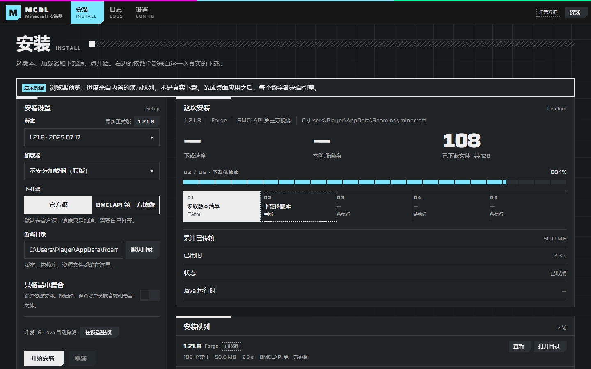

<div align="center">

# MCDL

**Minecraft 安装器 —— 只负责把游戏装好，不负责启动它**

[](../../actions)
[](LICENSE)
[](https://www.rust-lang.org/)
[](https://tauri.app/)

从 Mojang 官方服务器下载游戏本体、依赖库与资源文件，按你的选择装上模组加载器。
开源、免费、无广告、不需要注册任何账号。



</div>

---

## 它做什么

- **原版全版本安装** —— 从正式版到快照，按 `rules` 精确过滤依赖库，逐个校验 SHA1
- **四个模组加载器** —— Fabric / Quilt / Forge / NeoForge，一律调用官方 installer，行为与官方一致
- **Java 运行时** —— 本机没有合适的版本时，从 Adoptium 取一份 JRE 放进游戏目录
- **安装前预估** —— 点开始之前就告诉你这次要下多少文件、多少字节、用哪个 Java
- **版本管理** —— 扫描磁盘列出已装版本，可单独删除；只删自己的目录，共享的库不动
- **版本隔离** —— 模组装进 `versions/<版本id>/mods/`（默认开），同目录装第二个整合包不会混；
  隔离目录只有 PCL / HMCL 这类支持隔离的启动器读得到，官方启动器请关掉开关
- **多目录** —— 常用的 `.minecraft` 目录可以收藏、切换
- **命令行与图形界面共用一个引擎** —— 单文件 CLI 3.96 MiB，没有 GUI 也能装

## 它不做什么

这些是刻意的取舍，不是还没做：

| 不做 | 原因 |
| --- | --- |
| 不托管任何游戏文件 | 所有文件都从 Mojang 官方服务器取 |
| 不提供离线模式 | 请使用自己的正版账号 |
| 不内置整合包、不建资源站 | 不承担内容分发 |
| 不启动游戏 | 装完请用你自己的启动器打开 `versions/` 下的实例 |
| 不收集任何本机数据 | 没有遥测、没有账号体系 |

## 支持矩阵

| | 状态 |
| --- | --- |
| 原版 | 1.5.2 / 1.6.4 / 1.12.2 / 1.13.2 / 1.20.4 / 1.21.1 / 26.3 实测通过 |
| Fabric | ✅ 真装验证 |
| Quilt | ✅ 真装验证 |
| Forge | ✅ 真装验证（1.20.4 / 1.21.1） |
| NeoForge | ✅ 真装验证（1.21.1 + 21.1.264） |
| 平台 | Windows（主力）；Linux / macOS 理论可用，未实测 |

## 安装

### 图形界面

从 [Releases](../../releases) 下载对应平台的安装包。

### 命令行

```bash
# 从源码构建
cargo build --release -p mcdl
# 或者装进 PATH
cargo install --path crates/mcdl-cli
```

```bash
# 看有哪些版本
mcdl versions --release-only

# 装原版
mcdl install 1.21.1 --dir "D:/Games/.minecraft"

# 装原版 + Fabric
mcdl install 1.21.1 --loader fabric --dir "D:/Games/.minecraft"

# 只装能启动的最小集合（跳过资源文件）
mcdl install 1.21.1 --no-assets --dir ./tmp
```

> 路径用正斜杠，bash / PowerShell / cmd 都能直接粘。

## 实测数据

Windows / x86_64 / 千兆网，不是估算：

| 场景 | 耗时 | 体积 |
| --- | --- | --- |
| 1.20.4 原版全量（3853 文件） | 173 s | 708.8 MB |
| 26.3 原版全量（5222 文件） | 217 s | 585.6 MB |
| 1.12.2 原版全量 | 63 s | 172.5 MB |
| 1.21.1 + Fabric | 152 s | 93.6 MB（不含资源） |
| 1.21.1 + NeoForge | 136 s | 176.8 MB（不含资源） |
| 二次安装（全部命中缓存） | 1.5 s | 0 文件 / 0 字节 |

所有 `client.jar` 的 SHA1 与官方一致；依赖库数量与按 `rules` 语义独立算出的结果完全吻合。

## 下载源

默认全部走 Mojang 官方源。界面和命令行都可以切到 **BMCLAPI**（社区维护的第三方镜像）加速，
但版本清单和版本 JSON 永远走官方，避免镜像被改写。

NeoForge 官方源直接指向 `neoforged.forgecdn.net`——它和 `maven.neoforged.net` 是同一份内容，
后者在国内经常解析到污染地址。

## 常见问题

**装完之后怎么启动？**
本工具只负责装。用 PCL、HMCL、Prism 或官方启动器打开同一个 `.minecraft` 目录，
`versions/` 下会出现装好的实例。

**为什么 NeoForge 要单独从 CDN 取库？**
NeoForge 的 installer 不认 `--mirror` 参数（实测 68 个库仍直连原站）。所以我们先从官方 CDN
把库预取到 `libraries/`，installer 发现文件已存在就会跳过下载。

**1.6 及更早的版本为什么占两倍空间？**
这些版本按资源名读文件，需要把 `assets/objects` 再铺一份到 `resources/`（1.5.2 约多占 50 MB）。

**安装卡在 99% 不动？**
已修复。原因是下载大文件时总超时被放宽到 30 分钟，僵死的 TCP 连接会一直占住 worker。
现在单次读超过 30 秒没有字节就判失败重试。

**取消之后会不会留一堆垃圾？**
不会。取消或出错时会清掉这次新造的 `versions/<id>/`；已经下好的 `libraries/`、`assets/`
会保留——它们是内容寻址的共享缓存，下次直接复用。

## 从源码构建

```bash
git clone https://github.com/mc506lw/MCDL.git
cd MCDL

cargo test -p mcdl-core          # 引擎测试（联网用例默认跳过）
cargo run -p mcdl -- versions    # 跑一下 CLI

cd app
pnpm install
pnpm tauri dev                   # 开发模式，带热更新
pnpm tauri build                 # 打包
```

需要 Rust 1.82+、Node 22+、pnpm 11+。Linux 上编译 Tauri 还需要 `libwebkit2gtk-4.1-dev` 等系统依赖。

## 项目结构

```
crates/mcdl-core     引擎（无 UI 依赖）
  meta/              Mojang 元数据：版本清单、inheritsFrom 合并、rules 求值
  net/               HTTP 客户端与下载源
  download/          并发下载、SHA1 校验、.part 原子落盘、natives 解压
  loader/            Fabric / Quilt / Forge / NeoForge
  java/              运行时探测、版本推断、Adoptium 获取
  installed.rs       已装版本的扫描与删除
  isolate.rs         版本隔离：模组落点（versions/<id>/mods 还是根 mods）
  install.rs         编排层（唯一入口）
crates/mcdl-cli      命令行
app/                 Tauri 2 + React 界面
docs/                架构、加载器说明、界面、CI、i18n
```

细节见 [docs/ARCHITECTURE.md](docs/ARCHITECTURE.md)、[docs/LOADER-NOTES.md](docs/LOADER-NOTES.md)。

## 致谢

没有这些项目，MCDL 不会存在：

- [Mojang Studios](https://www.minecraft.net/) —— 游戏本身与公开的 launcher 元数据接口
- [FabricMC](https://fabricmc.net/) / [QuiltMC](https://quiltmc.org/) / [MinecraftForge](https://minecraftforge.net/) / [NeoForged](https://neoforged.net/) —— 四个加载器与它们的 installer
- [Adoptium](https://adoptium.net/) —— Temurin JRE
- [BMCLAPI](https://bmclapi2.bangbang93.com/) —— 社区镜像
- [Tauri](https://tauri.app/) / [React](https://react.dev/) —— 桌面外壳
- [Saira](https://github.com/Omnibus-Type/Saira) —— 界面拉丁字体（SIL OFL 1.1）

## 许可证

引擎与界面：[MIT](LICENSE)。

模组加载器的安装一律调用官方 installer 的 headless 模式，不复制它们的源码：

- [MinecraftForge/Installer](https://github.com/MinecraftForge/Installer) — LGPL-2.1
- [FabricMC/fabric-installer](https://github.com/FabricMC/fabric-installer) — Apache-2.0

界面字体 Saira 采用 SIL Open Font License 1.1，许可证随包附带。

## 免责声明

MCDL 不托管、不镜像、不分发任何 Minecraft 游戏文件。所有文件均从 Mojang 官方服务器
（或用户手动开启的第三方镜像）获取。

使用本工具获取 Minecraft 文件的前提，是你已经拥有对应的正版授权。
本项目与 Mojang Studios、Microsoft、网易无关。

---

<div align="center">

**MCDL** · 装好就走

</div>
